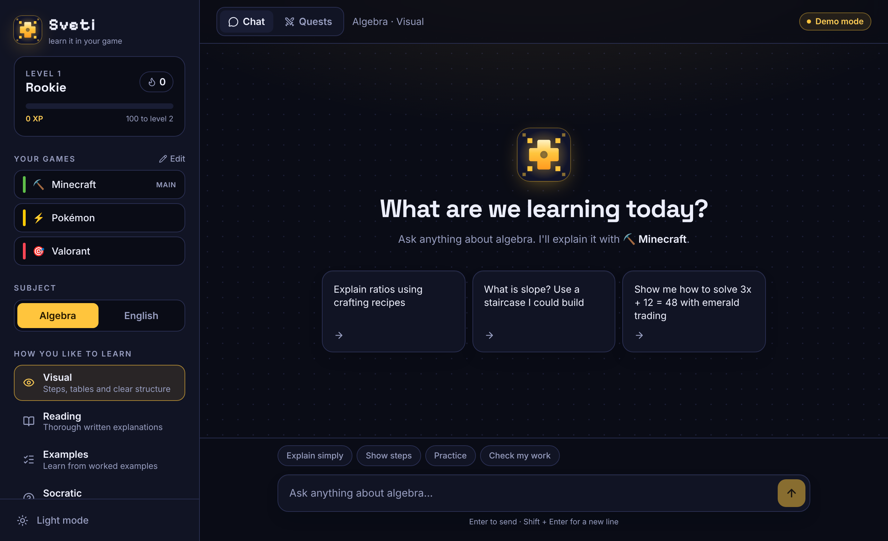
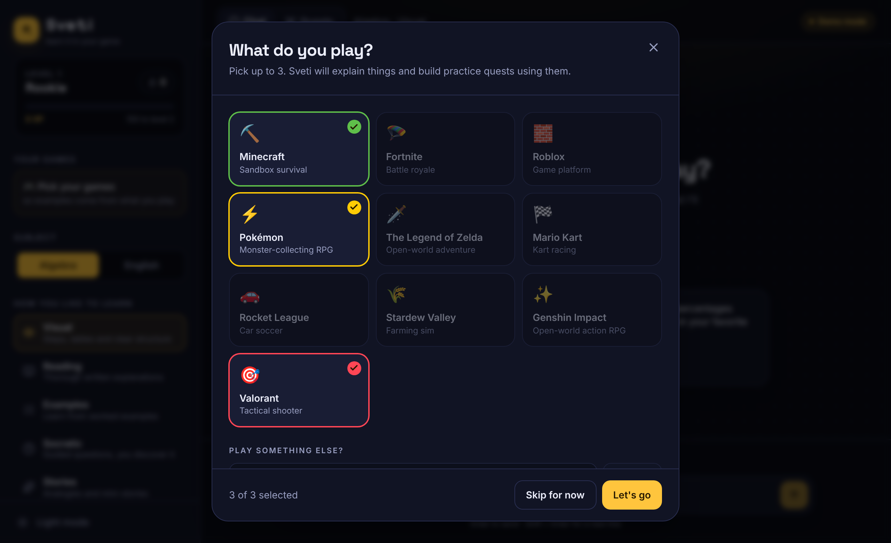
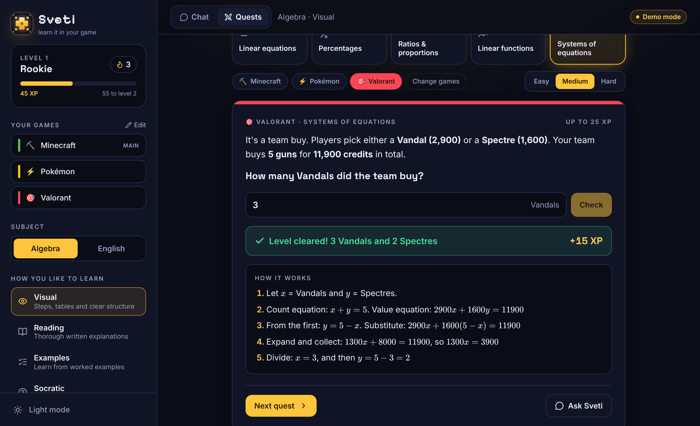
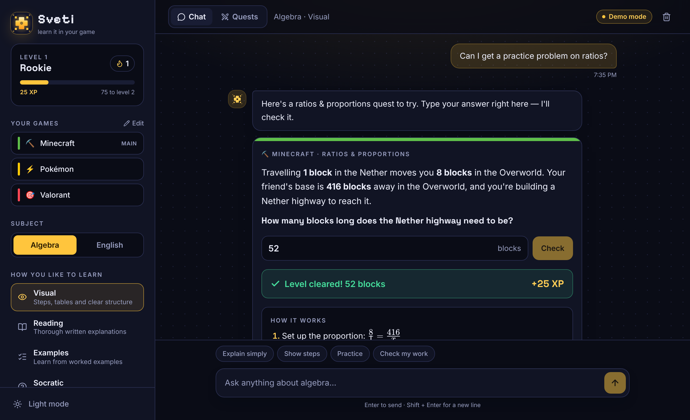
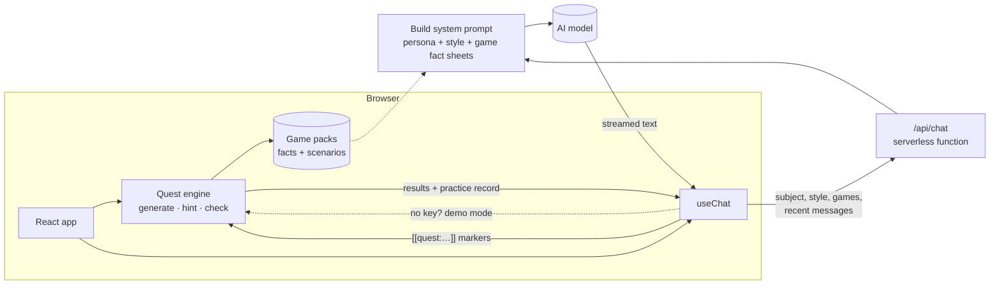

<div align="center">


# Sveti

**An AI tutor that teaches algebra and writing through the video games you actually play.**

[**▶ Live demo**](https://sveti-claude.vercel.app/) · [How it works](#how-it-works) · [Run it locally](#run-it-locally) · [Add a game](#add-your-own-game)




</div>

---

> *"Why do I need to know this?"*
>
> Because **1 coal smelts 8 items**, a **Vandal costs 2,900 credits**, and **Roblox keeps 30% of your game pass**. You've been doing algebra for years. Nobody told you.

*Sveti* (свети) is Russian for **"shine"** or **"give light"** — the idea is to illuminate schoolwork using something a student already cares about. Tell Sveti what you play, and every explanation, example and practice problem is set inside that game, using its **real items, prices and mechanics**.

## What it does

| | |
|---|---|
| 🎮 **Speaks your game** | Pick up to three games. Ten come with hand-written fact sheets (Minecraft, Fortnite, Roblox, Pokémon, Zelda, Mario Kart, Rocket League, Stardew Valley, Genshin Impact, Valorant). Type any other game and the AI uses what it knows about it. |
| ⚔️ **Quests** | Endless practice problems in five algebra topics and three difficulties, themed to your game. Answers are checked instantly, with a three-step hint ladder and a full worked solution. |
| 🔗 **Chat and quests work together** | Ask for practice and the tutor drops a live, auto-graded quest right into the conversation. It then sees exactly which problem you got and how you did, and it knows your practice record, so it can step the difficulty up or down. |
| 💬 **AI tutor chat** | Streaming replies with properly typeset math. It teaches the method instead of handing over answers, and checks your work honestly. |
| 🧠 **Five learning styles** | Visual, Reading, Examples, Socratic or Stories — the same idea, explained the way you learn best. |
| ✍️ **English too** | A writing coach that uses your game's world and debates as material, and never writes the essay for you — plus grammar and thesis drills built from your game's vocabulary. |
| 🔥 **XP, levels and streaks** | Solve quests cleanly to level up. Hints cost a little XP; peeking at the solution costs your streak. |
| 🔌 **Works without an AI key** | Quests run entirely in the browser. With no key, chat switches to a clearly-labelled demo mode that still teaches with real worked examples. |
| 🔒 **Key stays on the server** | The browser never sees the API key, and the chat endpoint is rate-limited per visitor. |

<div align="center">



</div>

## Quests: real game math, checked instantly

A quest isn't "Minecraft" pasted onto a textbook problem. Each game pack knows how its game works, so the math is the math you'd genuinely do while playing:

| Game | The quest | The algebra |
|---|---|---|
| ⛏️ Minecraft | Your base is 2,400 blocks away. How long is the Nether highway? | Proportions (1 : 8) |
| 🎯 Valorant | You have 2,300 credits and need a Vandal. How many kills? | `200x + 2300 = 2900` |
| 🧱 Roblox | Your game pass costs 250 Robux. What do you keep after the fee? | 70% of a number |
| 🚗 Rocket League | You spawn with 33 boost and arrive with 69. How many small pads? | `12x + 33 = 69` |
| ⚡ Pokémon | 9 balls, ₽3,800 spent, Great Balls and Poké Balls. How many of each? | System of equations |
| 🌾 Stardew Valley | A gold-quality pumpkin sells for 50% more than 320g. | Percent increase |

<div align="center">



</div>

## The tutor hands out quests

<div align="center">



</div>

When the tutor wants you to practice, it writes a tiny marker such as `[[quest:ratio:2]]`. The app swaps it for a real exercise in your game. On the next turn the tutor is shown the exact problem, the correct answer and your result (*"solved, 2 attempts, 1 hint"*), so the conversation continues from what actually happened.

Quests are generated and graded by plain, deterministic code — not by the AI — so **the answer key is never wrong**. The test suite generates around fifteen thousand quests and drills across every game, topic and difficulty and checks each one.

## How it works



1. **Game packs** (`src/config/games.js`) hold everything Sveti knows about a game: a fact sheet of real mechanics, conversation starters, and one quest scenario per algebra topic.
2. **The practice engine** (`src/lib/`) turns a scenario into a full problem — answer, three hints, worked solution — and checks whatever the student types (`12`, `x = 12`, `1,200 V-Bucks`, `3/4`, `25%` all work). English drills are multiple choice, built from each game's vocabulary.
3. **The tutor prompt** (`src/config/prompts.js`) combines the subject persona, the chosen learning style and the fact sheets for the student's games, with rules like *use real mechanics, never invent stats, don't give away homework answers*.
4. **The backend** (`server/chat.js`, deployed as `api/chat.js`) builds that prompt on the server, calls the model and streams the reply. The browser only sends structured choices, so the endpoint can't be used as a free general-purpose AI proxy.
5. **Demo mode**: if the server has no key, chat answers come from the quest engine instead, as worked examples in the student's game.

More detail in [ARCHITECTURE.md](ARCHITECTURE.md).

## Run it locally

You need Node.js 20+.

```bash
npm install
```

```bash
cp .env.example .env
```

```bash
npm run dev
```

Open http://localhost:5173. Without a key you get demo mode (quests fully work). To turn on the AI tutor, put your OpenAI key in `.env`:

```
OPENAI_API_KEY=sk-...
```

| Command | What it does |
|---|---|
| `npm run dev` | Dev server, including the `/api/chat` backend |
| `npm test` | Run the test suite (Vitest): logic, the server endpoint, and the UI |
| `npm run lint` | ESLint |
| `npm run build` | Production build to `dist/` |
| `npm run preview` | Serve the production build, with the backend |

### Environment variables

All of these are **server-side only**.

| Variable | Required | Purpose |
|---|---|---|
| `OPENAI_API_KEY` | For AI chat | Your OpenAI key. Without it the app runs in demo mode. |
| `OPENAI_MODEL` | No | Model name. Defaults to `gpt-4o-mini`. |
| `OPENAI_BASE_URL` | No | Point at any OpenAI-compatible API. |
| `VITE_INTENT_SERVICE_URL` | No | Use the optional Python intent service instead of the built-in rules. |

### Deploy

The app is set up for [Vercel](https://vercel.com): import the repo, add `OPENAI_API_KEY` under **Settings → Environment Variables**, and deploy. Vercel serves the static app and runs `api/chat.js` as a serverless function.

## Add your own game

Game packs are plain data plus five small functions. Add an entry to `GAMES` in `src/config/games.js`:

```js
{
  id: 'celeste',
  name: 'Celeste',
  emoji: '🍓',
  tint: '#e5484d',
  genre: 'Precision platformer',
  aliases: [],
  facts: ['There are 175 strawberries in the base game.', /* … */],
  starters: ['Explain percentages using strawberries collected'],
  writing: ['Help me analyze how the mountain works as a metaphor'],
  scenarios: {
    percent: (r) => {
      const found = r.by(35, 70, 105) // easy, medium, hard
      return Q.percent({
        kind: 'what', part: found, whole: 175, unit: '%',
        story: `You've collected **${found}** of the **175 strawberries**.`,
        ask: 'What percent have you found?',
      })
    },
    // linear, ratio, fn, system …
  },
}
```

You pick the numbers and tell the story; the builders in `src/lib/builders.js` produce the answer, hints and solution. Run `npm test` — the suite automatically checks every scenario of every game.

## Tech stack

- **Frontend:** React 19, Vite 7, Tailwind CSS 3.4, lucide-react
- **Math & Markdown:** react-markdown, remark-math, KaTeX, GitHub-flavoured tables
- **Backend:** one Node serverless function using the OpenAI SDK, with streaming
- **Tests:** Vitest + React Testing Library, run on every pull request by GitHub Actions
- **Optional:** a FastAPI rule-based intent classifier in [`server-python/`](server-python/)

## Project layout

```
api/chat.js            Vercel function (thin wrapper)
server/chat.js         Backend core: validation, prompt, streaming
src/
  App.jsx              Layout, view switching, theme
  components/          Sidebar, ChatView, QuestView, PracticeCard, GamePicker, Message, …
  config/
    games.js           Game packs: facts, starters, quest scenarios
    prompts.js         Subjects, quick actions, system prompt
    learningStyles.js  The five teaching styles
  lib/
    builders.js        Problem builders (the math + hints + solutions)
    quests.js          Algebra quest generation, answer checking, XP
    drills.js          English grammar and thesis drills
    practice.js        One API for both, chat markers, practice record
    intent.js          Intent + topic detection
    localTutor.js      Demo-mode replies
  hooks/               useChat, useGamePrefs, useProgress, useLocalStorage
tests/                 Logic, server and UI test suites
server-python/         Optional FastAPI intent service
```

## Roadmap

See [TODO.md](TODO.md). Next up: more game packs, quests for more topics (inequalities, exponents, quadratics), a shared-store rate limiter, and saved progress across devices.

---

<div align="center">

Sveti is an independent learning project and is **not affiliated with, endorsed by, or sponsored by** any game or publisher mentioned here. Game names are trademarks of their respective owners and are used only to describe the games.

</div>
